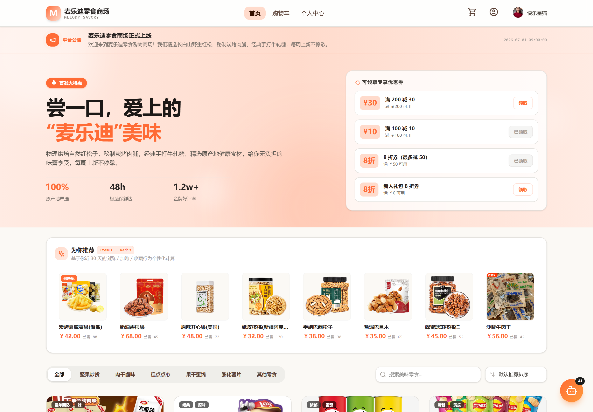
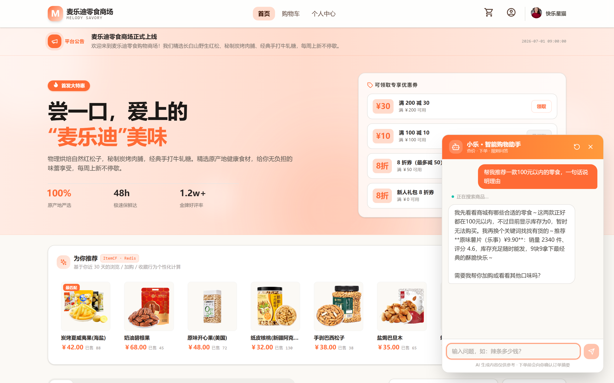
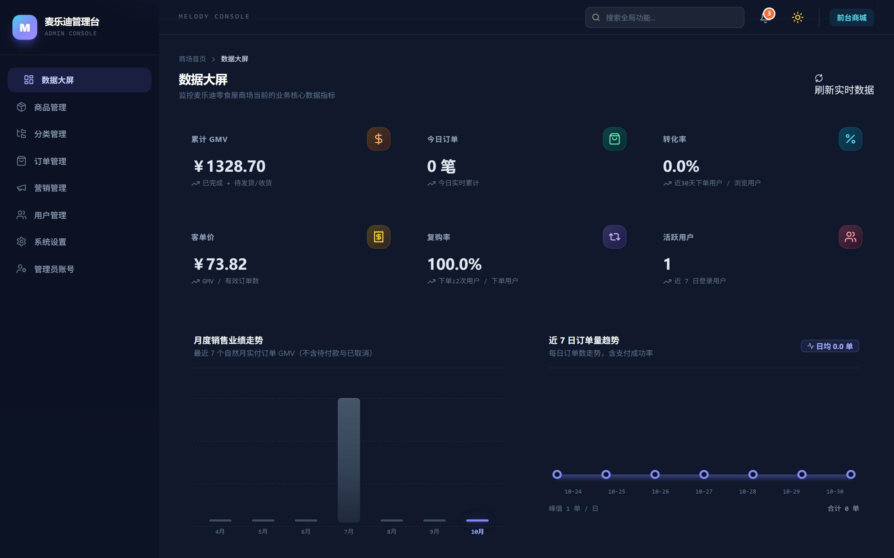
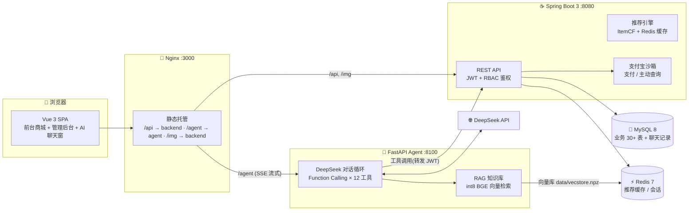
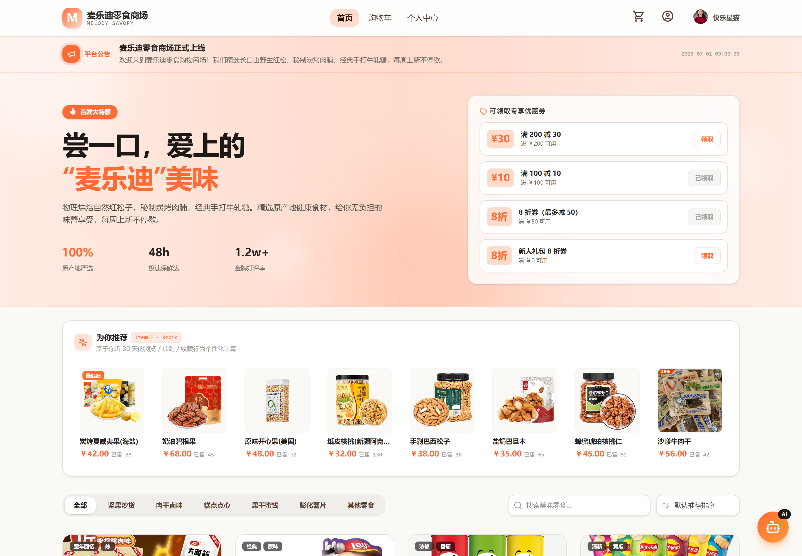
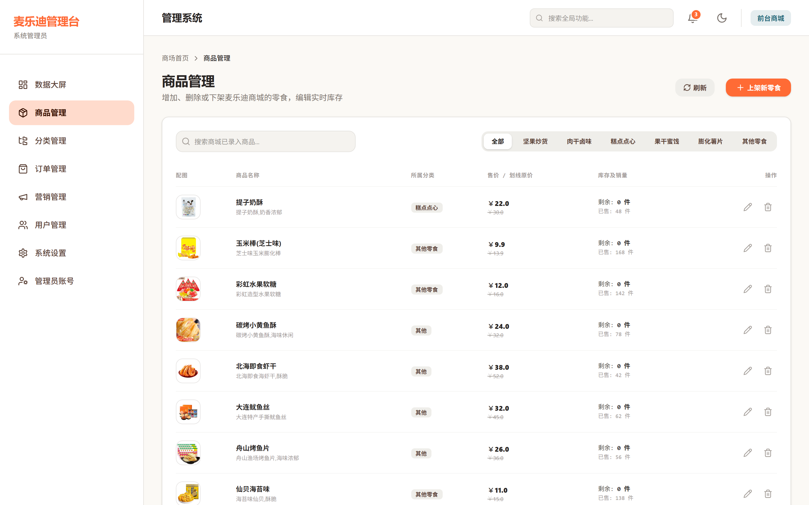

<div align="center">

# 🍿 麦乐迪零食购物商场系统

**Melody Savory Shop** — 基于 Spring Boot 3 + Vue 3 的前后端分离垂直零食电商，
集成 **个性化推荐（ItemCF）** 与 **DeepSeek 智能购物助手（Function Calling + RAG）** 两大亮点模块

[](https://spring.io/projects/spring-boot)
[](https://vuejs.org/)
[](https://www.mysql.com/)
[](https://redis.io/)
[](https://platform.deepseek.com/)
[](https://fastapi.tiangolo.com/)
[](https://www.docker.com/)
[](#-免责声明)

[快速开始](#-快速开始) · [系统架构](#-系统架构) · [功能总览](#-功能总览) · [AI 智能助手](#-ai-智能购物助手) · [项目结构](#-项目结构) · [测试](#-测试)

**前台商城** · 实拍截图



**智能购物助手（小乐）** · DeepSeek 实时对话 + 商品检索



**管理后台 · 数据大屏（深色模式）** · 左右两张为同一系统的双主题形态



</div>

---

## 📑 目录

- [✨ 功能总览](#-功能总览)
- [🏗️ 系统架构](#️-系统架构)
- [🚀 快速开始](#-快速开始)
  - [方式一：Docker 一键部署（推荐）](#方式一docker-一键部署推荐)
  - [方式二：本地裸机开发](#方式二-本地裸机开发)
- [🔑 演示账号](#-演示账号)
- [🤖 AI 智能购物助手](#-ai-智能购物助手)
- [📸 界面速览](#-界面速览)
- [📁 项目结构](#-项目结构)
- [🧪 测试](#-测试)
- [🛠️ 技术栈明细](#️-技术栈明细)
- [⚠️ 免责声明](#️-免责声明)

---

## ✨ 功能总览

**前台商城（用户端）**

| 模块 | 说明 |
|------|------|
| 🛍️ 商品浏览 | 分类导航 / 关键词搜索 / 多维排序 / SKU 规格选择 / 详情轮播与评价 |
| 🛒 购物车 | 增删改查、勾选结算、库存实时校验 |
| 📦 订单中心 | 下单（余额 / 支付宝沙箱双通道）、取消、确认收货、退款申请、订单跟踪 |
| 🎫 营销体系 | 优惠券领取 / 核销（满减 + 折扣双类型，终身限领一次）、会员等级（V0–V3） |
| 💰 钱包中心 | 余额支付 / 充值 / 退款到账 / 流水明细 |
| ⭐ 商品评价 | 仅购买过可评价、一人一评防重、评分自动回写商品 |
| 🎯 个性化推荐 | 基于浏览 / 加购 / 购买行为的 **ItemCF 协同过滤**，Redis 缓存 + 定时预热 |
| 🤖 AI 购物助手 | 右下角悬浮客服：查价 / 加购 / 下单 / 规则问答（RAG），见[下文](#-ai-智能购物助手) |
| 🧾 售后工单 | 退款/投诉多 Agent：意图识别 → 订单物流 → 风控 → 政策 → 自动退款/转人工 |

**管理后台（Admin）**

| 模块 | 说明 |
|------|------|
| 📊 数据大屏 | GMV / 转化率 / 复购率等 6 项 KPI + 月度走势 + 订单趋势 + TOP10（深浅双主题） |
| 📦 商品管理 | 上下架 / 多规格 SKU 独立定价 / 本机图片库选图 |
| 🧾 订单管理 | 全状态筛选、一键发货、退款审核、订单详情时间线 |
| 👥 用户管理 | 会员等级筛选、赠送积分、冻结 / 解锁 |
| 📣 营销管理 | 优惠券创建 / 停用 / 删除，实时剩余量 |
| 🧾 售后工作台 | 售后工单列表 / 详情，高风险工单人工审核（通过退款 / 拒绝） |
| 🔐 系统管理 | RBAC 管理员账号、操作日志审计、新订单 SSE 实时弹窗 |

---

## 🏗️ 系统架构



**AI 助手下单安全护栏**：`place_order` 未带 `user_confirmed` 时服务端实时组装订单摘要并拒绝执行，
LLM 须向用户完整展示摘要、获得确认后原参数重调，且购物车项 + 地址签名不一致仍拒绝——杜绝大模型幻觉下单。

---

## 🚀 快速开始

### 方式一：Docker 一键部署（推荐）

> 前置：Docker Desktop 已启动。首次构建约 5–15 分钟（已配国内镜像源）。

```bash
# 1. 准备环境变量（填入 DeepSeek API Key 和 JWT_SECRET）
cp .env.docker.example .env.docker
#    编辑 .env.docker → DEEPSEEK_API_KEY=sk-xxxx
#                      → JWT_SECRET=（至少 32 位随机字符串，可用 openssl rand -base64 36）

# 2. 构建并启动全部 5 个容器（MySQL 首次启动自动建库 + 导入演示数据）
docker compose --env-file .env.docker up -d --build

# 3. 查看状态，等全部 healthy
docker compose ps

# 4. 打开商城
#    前台/后台:  http://localhost:3000
#    后台入口:   http://localhost:3000/admin/login
```

> 详细说明（端口占用、数据重置、常见问题）见 [docs/docker-deploy.md](docs/docker-deploy.md)

### 方式二：本地裸机开发

<details>
<summary><b>展开步骤</b>（JDK 17+ / Maven / Node 18+ / MySQL 8 / Redis 7）</summary>

```bash
# 1. 数据库：创建 melody_shop 库后按序导入
mysql -u root -p < backend/sql/schema.sql
mysql -u root -p melody_shop < backend/sql/data-init.sql
mysql -u root -p melody_shop < backend/sql/order-alipay-columns.sql
mysql -u root -p melody_shop < backend/sql/insert-50-new-products.sql
mysql -u root -p melody_shop < backend/sql/wallet-recharge-order.sql
mysql -u root -p melody_shop < backend/sql/migrate-to-local-images.sql
mysql -u root -p melody_shop < backend/sql/after-sales-tables.sql

# 2. 后端（读取 gitignored 的 application-local.yml 中的本地密码/JWT/支付宝密钥）
cd backend
copy src\main\resources\application-local.yml.example src\main\resources\application-local.yml
#    编辑 application-local.yml：MySQL 密码、JWT_SECRET、AFTER_SALE_INTERNAL_TOKEN、支付宝沙箱密钥
mvn spring-boot:run                      # :8080

# 3. AI 助手（售后 LangGraph 模块需 Python 3.11/3.12/3.13，暂不支持 3.14）
cd melody-agent
python -m venv venv && venv\Scripts\pip install -r requirements.txt
copy .env.example .env                   # 填入 DEEPSEEK_API_KEY、AFTER_SALE_INTERNAL_TOKEN
venv\Scripts\python scripts\build_kb.py  # 构建 RAG 向量库（首次自动下载 24MB 模型）
venv\Scripts\python run.py               # :8100

# 4. 前端
cd frontend_google1 && npm install && npm run dev   # :3000
```

</details>

---

## 🔑 演示账号

| 端 | 账号 | 密码 | 说明 |
|----|------|------|------|
| 前台用户 | `13800138001` | `password` | V1 会员，含历史订单 / 收货地址 |
| 前台用户 | `13800138002` | `password` | V3 会员，多订单演示 |
| 后台管理员 | `admin` | `admin123` | 超级管理员，全部权限 |
| 后台管理员 | `operator` | `password` | 运营管理员 |

> 支付宝为**沙箱环境**，沙箱买家账号需在 [open.alipay.com](https://open.alipay.com) 沙箱控制台查看。

---

## 🤖 AI 智能购物助手

右下角悬浮窗「小乐」，基于 **DeepSeek Chat + Function Calling + RAG** 的三能力 Agent：

| 能力 | 说明 |
|------|------|
| 🔍 商品查询 | `search_products` / `get_product_detail`——价格、库存、SKU 实时查询，严禁编造 |
| 🛒 代客下单 | 加购 → 选地址 / 优惠券 → **展示订单摘要 → 用户确认 → 下单**（三重护栏见架构说明） |
| 📋 数据查询 | 订单 / 优惠券 / 钱包余额 / 积分（转发用户 JWT，以本人身份调用商城 API） |
| 📚 规则问答 | 优惠券规则 / 退款政策 / 会员等级等 6 篇知识文档向量化入库，回答**强制先检索**，附来源 |

技术要点：会话上下文 MySQL 持久化（含全部工具调用链审计）、SSE 流式输出、滑动窗口上下文、
向量模型 `bge-small-zh-v1.5 int8`（本地 ONNX 推理，免 API Key）。

## 🧾 售后多 Agent（LangGraph）

用户发起退款/投诉后，由 LangGraph 编排一条**决策流水线**，而不是让 5 个 Agent 自由聊天：

```text
意图识别 → 订单/物流查询 → 风控评分 ∥ 政策检索 → 决策层 → 自动退款 / 转人工 → 回复
```

| 节点 | 实现 | 输出 |
|------|------|------|
| 意图识别 | LLM 结构化输出 + 规则兜底 | LOGISTICS / QUALITY / REFUND / MALICIOUS / OTHER + 订单号 |
| 订单/物流 | 确定性工具调用 | 订单状态、实付、物流单号与轨迹 |
| 风控 | Java 内部接口 + 规则评分 | 退款率、退款次数、账号年龄、黑名单、同商品重复退款 |
| 政策 | Markdown 政策库检索 + 确定性校验 | ELIGIBLE / NEED_EVIDENCE / INELIGIBLE / MANUAL + 条款来源 |
| 决策 | 确定性规则，不由 LLM 决定 | 低风险 + 可退 + 金额 ≤ 200 自动；高风险/大额/证据不足转人工 |
| 回复 | LLM 只做话术润色，事实来自模板 | 结论、退款金额、工单号、下一步 |

关键设计：

- **决策与退款分离**：LLM 只负责理解和表达，退款由决策规则 + Java 订单状态二次校验兜底；
- **人工接管**：高风险工单写入 `PENDING_REVIEW`，后台审核通过后才调用退款；
- **全链路审计**：`t_after_sale_ticket` + `t_after_sale_event` 记录每个 Agent 节点的事实与决策；
- **内部接口鉴权**：Python → Java 走 `X-After-Sale-Token`，不对公网暴露；
- **离线可跑**：无 LLM Key 时意图/回复自动降级为规则和模板，smoke 测试不依赖外网。

接口：Agent 服务 `POST /api/after-sales/chat`（SSE）、`GET /api/after-sales/tickets/{id}`；
Docker 下经 nginx 访问为 `/agent/api/after-sales/chat`。
后台：`/api/admin/after-sales/list`、`/{id}/decision`。

## 📸 界面速览

| 商品列表 | 管理后台 · 商品管理 |
|---|---|
|  |  |

---

## 📁 项目结构

```
melody/
├── backend/                 # Spring Boot 3 后端
│   ├── src/main/java/com/melody/
│   │   ├── controller/      # 用户端 + 管理端 REST 接口
│   │   ├── service/         # 业务逻辑（订单/优惠券/推荐 ItemCF/钱包…）
│   │   ├── mapper/          # MyBatis-Plus 数据层
│   │   └── config/          # Security/JWT/支付宝/推荐预热
│   ├── sql/                 # 建库脚本 + 演示数据（容器自动导入）
│   └── Dockerfile           # 多阶段构建（阿里云镜像源）
├── frontend_google1/        # Vue 3 前端（前台 + 管理后台同工程）
│   ├── src/views/frontend/  # 商城页面
│   ├── src/views/admin/     # 后台页面（含数据大屏）
│   ├── src/components/ChatWidget.vue   # AI 助手聊天窗
│   ├── nginx.conf           # 容器内反代配置
│   └── Dockerfile           # node 构建 → nginx 托管
├── melody-agent/            # Python AI 智能助手
│   ├── app/                 # agent 循环 / 工具集 / RAG / MySQL 持久化
│   │   └── after_sales/     # 售后多 Agent（LangGraph：意图/风控/政策/决策）
│   ├── knowledge/           # 平台规则 + 售后政策（RAG 语料）
│   ├── scripts/             # 建库 / 冒烟测试
│   └── Dockerfile
├── 项目测试/                 # 独立测试工程（L1 API / L2 鉴权矩阵 / L3 集成 / L4 UAT）
├── docs/                    # 部署文档 + 截图
├── topic/                   # PRD（SRS）与选题分析
├── image/                   # 商品图片（/img/** 静态资源源目录）
└── docker-compose.yml       # 5 服务一键编排
```

## 🧪 测试

独立测试工程 [`项目测试/`](项目测试/README.md)，四层覆盖：

| 层级 | 范围 | 通过标准 |
|------|------|----------|
| L1 API | 48 端点 happy path | 全过 |
| L2 鉴权矩阵 | 5 角色 × 5 端点 | 全过 |
| L3 集成 | 并发 / 降级 / 注入 | 全过 |
| L4 UAT | 4 大业务场景 | 全过 |

后端另有 JUnit 5 + H2 单元/集成测试（`backend/src/test`），前端 `npm run build` 校验。

## 🛠️ 技术栈明细

**后端** Spring Boot 3.2.5 · Spring Security + JWT · MyBatis-Plus · MySQL 8 · Redis 7 · 支付宝 SDK（沙箱）· SSE
**前端** Vue 3.4 (Composition API) · Vite 5 · Pinia · Vue Router · Tailwind CSS 4 · lucide 图标
**AI 服务** Python 3.11 · FastAPI · openai SDK (DeepSeek) · onnxruntime (bge-small-zh int8) · NumPy 向量检索 · PyMySQL
**部署** Docker Compose（nginx / spring / fastapi / mysql / redis，健康检查 + 按序启动）

## ⚠️ 免责声明

> 本项目为**计算机专业本科毕业设计作品，纯属学术研究用途**。
> 「麦乐迪」为虚构命名，不代表任何真实商业主体；商品图片、价格均为模拟数据；
> 支付、物流等第三方服务使用**沙箱环境或 Mock**，不产生真实交易。
