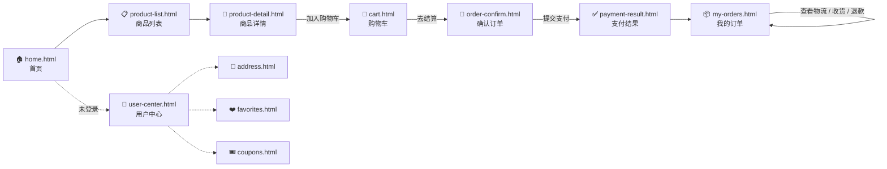
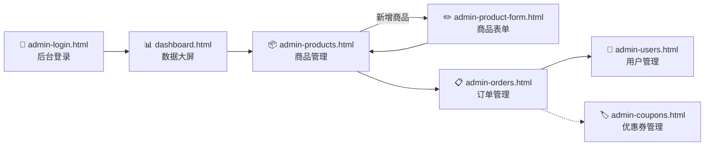

# 麦乐迪零食 · 页面原型设计稿

> 配套 PRD V1.1（[PRD.md](PRD.md)）的视觉交付物
>
> 本目录是 **18 个高保真 HTML 原型** + 1 个公共 CSS 的完整页面集合。

---

## 一、目录结构

```
原型/
├── index.html                 ← 入口导航页（双击打开）
├── README.md                  ← 本说明文件
├── styles/
│   └── common.css             ← 公共样式 + 设计 token + 组件库
├── home.html                  ← 🏠 前台首页（差异化 ⭐）
├── product-list.html          ← 📋 商品列表
├── product-detail.html        ← 🍟 商品详情（差异化 ⭐，含 SKU 联动）
├── cart.html                  ← 🛒 购物车
├── order-confirm.html         ← 📝 确认订单
├── payment-result.html        ← ✅ 支付结果
├── user-center.html           ← 👤 用户中心
├── my-orders.html             ← 📦 我的订单
├── address.html               ← 📍 收货地址
├── favorites.html             ← ❤️ 我的收藏
├── coupons.html               ← 🎟️ 我的优惠券
├── dashboard.html             ← 📊 后台数据大屏（差异化 ⭐）
├── admin-login.html           ← 🔐 后台登录
├── admin-products.html        ← 📦 后台商品管理
├── admin-product-form.html    ← ✏️ 后台商品表单（含 SKU 矩阵）
├── admin-orders.html          ← 📋 后台订单管理
├── admin-users.html           ← 👥 后台用户管理
└── admin-coupons.html         ← 🏷️ 后台优惠券管理
```

**共 18 个页面 + 1 个公共 CSS + 1 个导航页 + 1 个说明文件 = 21 个文件**

---

## 二、如何使用

### 方式 A：浏览器直接打开

```bash
# Windows
双击 "选题/原型/index.html"

# 或用命令行启动
start "d:\bishe\选题\原型\index.html"
```

### 方式 B：本地 http 服务（推荐用于演示）

```bash
cd 选题/原型
python -m http.server 8000
# 浏览器访问 http://localhost:8000
```

> 推荐用 http 服务方式打开，部分浏览器对本地 file:// 协议的某些 CSS 行为有限制。

---

## 三、设计规范

### 3.1 设计 Token

| 类别 | 颜色 | 用途 |
|------|------|------|
| **主色** | `#FF6B35` | 活力橙，CTA 按钮、品牌色 |
| **主色深** | `#E55A2B` | hover、按下态 |
| **主色浅** | `#FFF1EA` | 推荐位背景 |
| **辅助色** | `#FFB800` | 暖黄，强调、高亮 |
| **成功** | `#52C41A` | 完成、正向状态 |
| **警告** | `#FAAD14` | 库存预警 |
| **错误** | `#F5222D` | 退款、取消 |
| **信息** | `#1890FF` | 已支付、中性提示 |
| **文本-主** | `#333333` | 标题 |
| **文本-次** | `#666666` | 正文 |
| **文本-弱** | `#999999` | 辅文 |
| **背景灰** | `#F5F5F5` | 页面背景 |
| **后台侧栏** | `#001529` | 后台深蓝侧栏 |
| **大屏背景** | `#0A1628` | 渐变到 `#1A1A2E` |

### 3.2 排版规范

- **字体栈**：`-apple-system, "PingFang SC", "Microsoft YaHei", sans-serif`
- **主字号**：14px（基线），正文 13-16px
- **主圆角**：8px（小元素 4px，大卡片 16px）
- **阴影层级**：sm / md / lg 三档

### 3.3 页面尺寸

| 端别 | 设计稿宽 | 内容区宽 | 栅格 |
|------|---------|---------|------|
| 前台 | 1440px | 1200px 居中 | 12 列，24px gutter |
| 后台 | 1920px | 1680px（侧栏 240px + 主区） | 24 列，24px gutter |
| 大屏 | 1920px | 自适应 | - |

### 3.4 图表占位策略

- **图表**：使用内联 SVG + CSS（折线图/饼图/柱状图），保证完全离线可用
- **图片**：使用 CSS 渐变 + Emoji + 文字（如 "🍟 乐事薯片"）
- **头像**：首字母圆形 + 随机色

---

## 四、页面与功能编号对照表

### 前台用户端（11 个）

| 页面文件 | 对应 PRD 功能编号 | 差异化 |
|---------|------------------|:-----:|
| `home.html` | F-U-010 ~ F-U-015 | ⭐ 个性化推荐位 |
| `product-list.html` | F-U-020 ~ F-U-024 | - |
| `product-detail.html` | F-U-020 ~ F-U-027 | ⭐ SKU 联动 |
| `cart.html` | F-U-030 ~ F-U-036 | - |
| `order-confirm.html` | F-U-040 ~ F-U-047 | - |
| `payment-result.html` | F-U-046 | - |
| `user-center.html` | F-U-050 ~ F-U-056 | - |
| `my-orders.html` | F-U-052 | - |
| `address.html` | F-U-051 | - |
| `favorites.html` | F-U-053 | - |
| `coupons.html` | F-U-054 + §7.5 | V1.1 自动发放 |

### 后台管理端（7 个）

| 页面文件 | 对应 PRD 功能编号 | 差异化 |
|---------|------------------|:-----:|
| `dashboard.html` | F-D-001 ~ F-D-008 | ⭐ 数据可视化 |
| `admin-login.html` | F-A-060 | - |
| `admin-products.html` | F-A-020 ~ F-A-028 | - |
| `admin-product-form.html` | F-A-021 / F-A-028 | - |
| `admin-orders.html` | F-A-030 ~ F-A-035 | - |
| `admin-users.html` | F-A-040 ~ F-A-044 | - |
| `admin-coupons.html` | F-A-050 ~ F-A-054 | - |

---

## 五、页面跳转流程

### 5.1 用户购买主流程（前台 11 步）



### 5.2 商家运营主流程（后台 6 步）



### 5.3 推荐系统数据流（F-R 模块）

```mermaid
flowchart TD
  UI[前端埋点<br>浏览/加购/收藏/下单] --> API[/api/behavior]
  API --> DB[(user_behavior_log<br>行为日志表)]
  DB --> Job[离线任务<br>每日 3 点<br>@Scheduled]
  Job --> Redis[(Redis<br>推荐结果<br>TTL=24h)]
  Redis --> Rec[/api/recommend]
  Rec --> Home[首页为你推荐<br>home.html ⭐]
  Rec --> Detail[详情页猜你喜欢<br>product-detail.html ⭐]
```

---

## 六、演示账号（PRD §6.4）

| 账号 | 角色 | 成长值 | 钱包余额 | 历史行为 | 用途 |
|------|------|--------|---------|---------|------|
| `userA 张小糯` | 普通用户 | 800（V1 银卡）| ¥1000 | 200+ 条浏览、加购、收藏、下单 | 推荐效果演示 |
| `userB 李大嘴` | 会员用户 | 5500（V3 钻石）| ¥1000 | 100+ 条，含较多下单 | 会员等级/自动发券演示 |
| `userC 新用户C` | 新用户 | 0 | ¥1000 | 无任何行为 | 冷启动演示 |
| `admin` | 超级管理员 | - | - | - | 后台登录使用 |

---

## 七、答辩演示建议路径

### 推荐演示顺序（5 分钟）

1. **打开首页**（home.html）→ 讲解分类、轮播、推荐位（⭐ 第一次点出差异化）
2. **进入商品详情**（product-detail.html）→ 演示 **SKU 联动**（点不同口味，价格/库存变化）→ 切入第二个差异化点
3. **进入购物车 → 确认订单 → 支付结果**（一笔流程走完）
4. **进入用户中心 → 切换账号 userA/userC** → 回到首页看推荐差异（差异化效果）
5. **进入后台数据大屏**（dashboard.html）→ 全屏展示 → 讲解 6 KPI + 4 图表 + 实时订单
6. **进入订单管理** → 演示发货操作
7. **结束**

### 关键交互锚点

| 页面上 | 演示时操作 | 答辩话术 |
|--------|----------|---------|
| 首页推荐位 | 切换登录账号看差异 | "这是基于协同过滤的个性化推荐，差异源于行为日志" |
| 商品详情 | 点击不同口味/包装 SKU | "前端 JS 实现 SKU 联动，价格库存同步刷新" |
| 数据大屏 | 全屏 + 数字动态效果 | "深色大屏设计是答辩加分项，6 KPI + 4 类图表" |

---

## 八、与 PRD 对照说明

| PRD 内容 | 在原型中的体现 |
|---------|---------------|
| §4.0 编号规范 | 每个页面顶部都标了对应的 F-U/F-A/F-D 编号 |
| §4.1.2 首页 F-U-014 | 已删除（限时秒杀模块 V1.1 移除） |
| §4.1.3 F-U-027 SKU 选择 | `product-detail.html` 完整实现，可点击切换 |
| §4.2.5 F-A-053/F-A-054 | 已删除（秒杀 + 活动数据统计 V1.1 移除） |
| §6.1.1 t_product_sku 字段 | 在 `product-detail.html` 与 `admin-product-form.html` 都可对照 |
| §6.4 演示数据 | 见上方第六节，3 账号准备是答辩前的必备清单 |
| §7.5 会员等级自动发券 | `coupons.html` 中已标注自动发放，无需用户领取 |
| §7.1 订单状态机 | `my-orders.html` 与 `admin-orders.html` 状态标签对应 |
| §9.4 验收标准 | 18 个页面均为可演示状态 |

---

## 九、技术说明

- **零外部依赖**：所有页面使用纯 HTML + CSS + 极少 JS，**无需联网**
- **图片占位**：CSS 渐变 + Emoji 替代，避免因缺图破坏视觉
- **图表实现**：内联 SVG，纯静态（演示足够，无需 ECharts）
- **响应式**：未做移动端适配（毕设演示以 PC 为主）
- **可二次开发**：所有样式都基于 token，可直接用 SCSS/Less 重构

---

**原型交付状态：✅ 18 页面全部完成**
